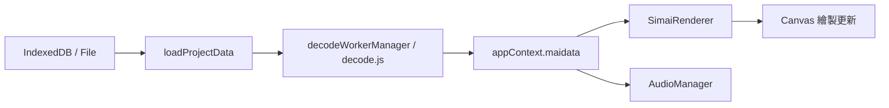

# Web mai Chart X - Agent 開發與架構指引 (AGENTS.md)

歡迎閱讀 **Web mai Chart X** 的 AI Agent 專案指引文件。本文件旨在為後續接手的各類 AI Agent（如 Antigravity、Claude Code、Cursor 等）提供專案架構概覽、檔案職責索引、核心資料流、關鍵設計約定與常見陷阱（Gotchas），協助快速定位問題並安全地進行功能擴充。

---

## 📌 專案概述 (Project Overview)

- **專案名稱**：Web mai Chart X (簡稱 WMCX)
- **專案定位**：基於 Web 技術的高效能、易用型 maimai 譜面線上編輯與預覽工具。
- **技術棧 (Tech Stack)**：
  - **核心架構**：原生現代 JavaScript (ES Modules, ESM)，無大型前端框架依賴，極致輕量。
  - **圖形渲染**：HTML5 Canvas 2D（高效能雙畫布/預覽畫布，支援多種音符幾何與動態快取）。
  - **音訊引擎**：Web Audio API（低延遲打擊音效播放、BGM 播放控制、波形圖解析）。
  - **離線與存儲**：Service Worker (Stale-While-Revalidate)、IndexedDB（專案與譜面資料持久化）。
  - **多語系 (i18n)**：BCP 47 自動系統語言偵測、DOM 熱更新、支援 5 種語言 (zh-TW, en, ja, zh-CN, ko)。
  - **本地開發**：`npx vite --host`（僅作為輕量開發靜態伺服器）。

---

## 🗺️ 專案目錄結構 (Directory Map)

```text
web-mai-chart-beta/
├── AGENTS.md                  # 本文件 (Agent 核心導引)
├── docs/                      # 詳細技術與模組文檔
│   ├── ARCHITECTURE.md        # 系統生命週期、資料流、EventBus 與 AppContext
│   ├── MODULES.md             # 模組詳細 API 與職責手冊 (core, features, modals, services)
│   └── RENDERER_AND_AUDIO.md  # Canvas 渲染核心與 Web Audio 音訊引擎詳解
├── Scripts/                   # 核心程式碼
│   ├── main.js                # 專案主進入點 (協調整合各模組)
│   ├── renderer.js            # Canvas 譜面渲染引擎 (SimaiRenderer, VisualEditor, Preview)
│   ├── audioManager.js        # Web Audio 音訊管理與音效判定播放
│   ├── decode.js              # simai 譜面語法解析器 (Token 解析、時間軸計算)
│   ├── helper.js              # 工具函式集 (數學運算、幾何、DOM 輔助、防抖節流)
│   ├── i18n.js                # 國際化多語言引擎 (BCP 47、語言切換、DOM 翻譯)
│   ├── indexDB.js             # IndexedDB 資料庫管理層
│   ├── majdataWs.js           # MajdataView 外部 WebSocket 協議橋接
│   ├── core/                  # 核心底層系統 (AppContext, EventBus, Playback, Settings...)
│   ├── features/              # 專用功能外掛 (視覺化編輯、切分、格式化、影片匯出...)
│   ├── modals/                # UI 彈窗元件 (歡迎導覽、設定、專案管理、Slide 編輯...)
│   ├── services/              # 外部雲端服務 (Google Drive 認證、API、同步)
│   └── workers/               # Web Workers (非同步譜面解析 decodeWorker)
├── Styles/                    # CSS 樣式表 (Material/深色毛玻璃風格)
├── _play/                     # 獨立譜面遊玩/演示模式 (衍生自 MajdataPlay)
├── locales/                   # 多語言 JSON 翻譯字典 (zh-TW, en, ja, zh-CN, ko)
├── config/                    # 應用程式設定與 manifest.json
├── sw.js                      # Service Worker 離線快取控制腳本
└── index.html                 # 應用程式主頁面
```

---

## 🧠 核心架構與資料流 (Core Architecture & Flow)

### 1. 全域上下文與解耦通訊
- **`appContext.js`**：中央服務容器與全域狀態（`settings`, `maidata`, `renderer`, `audioManager` 等）。請優先使用 `appContext` 取用共用實例，避免透過全域變數或深層 props drilling 傳遞。
- **`eventBus.js`**：輕量級發布/訂閱（Pub/Sub）中樞，定義了預設常數 `EVENTS`（如 `SETTINGS_CHANGED`, `PROJECT_LOADED`, `CANVAS_REDRAW` 等），模組間解耦均透過此匯流排通信。

### 2. 譜面資料載入流程

1. 使用者選擇專案或匯入檔案後，透過 `indexDB.js` 載入 raw data。
2. `main.js:loadProjectData` 調用 `decodeWorkerManager`（若 Worker 不可用則降級為同步 `simaiDecode`）。
3. 解析完成後將 notes、track、timeline 寫入資料結構，並同步更新音訊長度與 Canvas 時間軸。

### 3. 音畫同步與播放循環
- **`playbackEngine.js`** 管理播放、暫停、停止、倒轉與 Seek 等時間軸狀態。
- 透過 `requestAnimationFrame` 持續驅動 `SimaiRenderer.render(currentTime)`，同時音訊引擎由 Web Audio API 提供高精度時間基點。

---

## ⚠️ Agent 避坑與關鍵約定 (Crucial Gotchas & Rules)

在修改程式碼時，請務必遵循以下專案特定約定，以防破壞現有功能：

### 1. 模組引用規範 (Pure ESM)
- 專案為純原生 ES Modules，所有相對路徑 import **必須明確附帶副檔名**（例如：`import { t } from './i18n.js';`，缺少 `.js` 會導致瀏覽器載入失敗）。

### 2. Service Worker (離線快取與更新)
- **初次載入靜默快取**：首次訪問的用戶在安裝 Service Worker 時，**不可跳出下載進度條或版本更新彈窗**。
- `sw.js` 判斷 `isUpdate = Boolean(self.registration.active)`；`swManager.js` 判斷 `hasExistingController = Boolean(navigator.serviceWorker.controller)`。非版本更新不得觸發通知，切勿破壞此雙層守衛。

### 3. 渲染器 (renderer.js) 快取陷阱
- **Slide 與 NoteBaseSize 快取**：Slide 線段具有快取機制，若更動 `notebasesize` 或使用者樣式設定，需確保清空快取或連動更新 spacing，避免快取穿透導致縮放失真。
- **音訊波形圖 (Waveform)**：波形繪製消耗極大，已在 `SimaiPreviewRenderer` 等處設計離屏快取（Offscreen/Cached Canvas），請勿在每幀（60fps）中重複呼叫全量波形解算。

### 4. 音訊音量控制 (audioManager.js)
- 判定打擊音效播放函式支援音量倍率（例如 Break、Slide 音效：`judge_break_slide` 等）。若新增音效播放呼叫，請務必透過 `settings` 獲取對應項目的分流音量進行乘算，避免出現不受設定控制的音量。

### 5. 多語系 (i18n) 熱切換
- 新增任何 Modal 或 UI 元件時：
  - 靜態標籤需具備 `data-i18n="popup.xxx"` 屬性，或在語系變更監聽中提供局部重新整理方法。
  - 避免將 `t('key')` 的結果一次性硬寫進不會重繪的靜態閉包內，確保使用者在介面切換語言時能即時更新。

### 6. 使用者語言要求
- 根據使用者全域規範，回覆與說明**一律優先使用繁體中文 (Traditional Chinese)**。

### 7. 影片渲染與 Mediabunny API 查詢規範 (重大禁忌)
- 處理影片錄製、匯出或渲染問題（如 `videoRender.js`、`recordVideoModal.js`）時，**切勿直接讀取或分析 `Scripts/mediabunny.cjs`**（該檔為超過 36,000 行、1.4MB 的打包庫，分析極度耗費 Token 且效率低下）。
- 遇到 Mediabunny 相關問題，**必須優先查閱官方線上 API 文件**：[https://mediabunny.dev/api/](https://mediabunny.dev/api/)。

---

## 🛠️ 開發除錯與測試工具 (Dev & Debugging)

- **本地開發伺服器**：
  ```bash
  npx vite --host
  ```
  預設端口通常為 `http://localhost:5173/`。

- **JavaScript 語法檢查**：
  在修改重要檔案後，建議透過 node 進行靜態語法檢驗：
  ```bash
  node --check Scripts/main.js
  node --check Scripts/renderer.js
  node --check Scripts/core/swManager.js
  ```

- **瀏覽器全域除錯鉤子 (Console Hooks)**：
  專案在 `window` 上掛載了便於手動觸發與測試的 API：
  - `window.openWelcomeModal()`：手動開啟初次啟動導覽彈窗（含語言選擇器與問候標籤）。
  - `window.mockSwUpdateFlow()`：模擬 Service Worker 下載與更新就緒進度條。
  - `window.appContext`：直接檢視全域狀態、註冊服務與目前設定。

---

## 📚 延伸文檔目錄 (Detailed Docs)

更深入的技術細節請查閱 `docs/` 資料夾：
1. **[docs/ARCHITECTURE.md](file:///d:/Githubs/web-mai-chart-beta/docs/ARCHITECTURE.md)**：詳細系統架構、啟動生命週期、事件匯流排常數與資料流。
2. **[docs/MODULES.md](file:///d:/Githubs/web-mai-chart-beta/docs/MODULES.md)**：所有模組與檔案的 API 導出手冊與細部職責說明。
3. **[docs/RENDERER_AND_AUDIO.md](file:///d:/Githubs/web-mai-chart-beta/docs/RENDERER_AND_AUDIO.md)**：Canvas 譜面渲染架構、座標幾何、Web Audio 判定音效與快取優化。
