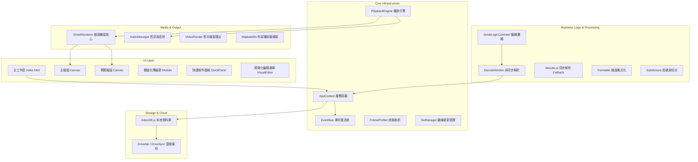
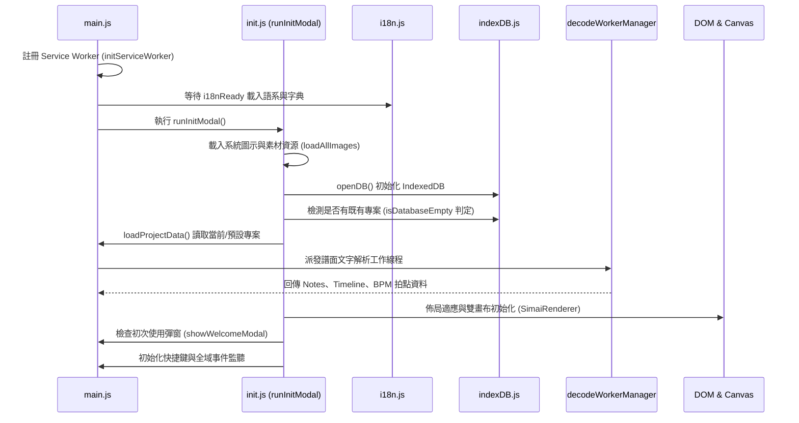

# Web mai Chart X - 系統架構與生命週期 (ARCHITECTURE.md)

本文件詳細闡述 **Web mai Chart X** 的系統全景架構、程式啟動生命週期、狀態管理容器、事件匯流排通訊機制以及資料庫持久化結構。

---

## 1. 系統全景架構圖 (System Architecture)

---

## 2. 啟動與初始化生命週期 (Initialization Lifecycle)

應用的啟動由 [Scripts/main.js](file:///d:/Githubs/web-mai-chart-beta/Scripts/main.js) 驅動，內部委派至 [Scripts/core/init.js](file:///d:/Githubs/web-mai-chart-beta/Scripts/core/init.js)，整個初始化流程分為以下階段：

### 關鍵判定：
- **`isDatabaseEmpty`**：用來判斷是否需要跳出初次啟動導覽彈窗（`showWelcomeModal`）。若資料庫已有歷史專案，系統自動標記完成，不打擾既有使用者。
- **`decodeWorkerManager`**：優先使用背景 Worker 解析譜面文字以防主線程卡死，若 Worker 失敗則自動降級至同步 `simaiDecode()` 執行。

---

## 3. 狀態管理：AppContext 容器

專案摒棄傳統的深層 Props Drilling，改採單一實例的服務容器模式（[Scripts/core/appContext.js](file:///d:/Githubs/web-mai-chart-beta/Scripts/core/appContext.js)）：

- **主要儲存項目 (`this.state`)**：
  - `settings`：使用者當前全部設定（外觀、音量、延遲、PinkStars 等）。
  - `maidata`：目前載入中譜面的元資料（Title, Artist, BPM, Offset 等）。
  - `currentProjectId`：當前編輯中專案在 IndexedDB 的主鍵 ID。
  - `images`：快取的圖片與 Skin 紋理物件。
  - `isInitComplete` / `isImagesLoaded`：初始化狀態旗標。
- **實例捷徑 (`Getters`)**：
  - `appContext.renderer`：取得主畫布渲染器實例。
  - `appContext.audioManager`：取得音訊管理器實例。
  - `appContext.playbackEngine`：取得播放引擎實例。
- **設定變更通知**：
  呼叫 `appContext.setSetting(key, value)` 會自動透過 `eventBus` 派發 `EVENTS.SETTINGS_CHANGED` 事件，訂閱者可即時反應（如外觀換膚、音量即時更新）。

---

## 4. 模組解耦：EventBus 事件通訊

[Scripts/core/eventBus.js](file:///d:/Githubs/web-mai-chart-beta/Scripts/core/eventBus.js) 提供發布/訂閱支援，常用事件常數列於 `EVENTS`：

| 事件常數 | 名稱 | 傳遞參數 | 說明 |
| :--- | :--- | :--- | :--- |
| `SETTINGS_CHANGED` | `settings:changed` | `{ key, value, oldVal, allSettings }` | 設定值更動時觸發 |
| `SETTINGS_SAVED` | `settings:saved` | `{ allSettings }` | 設定被儲存至持久層 |
| `CANVAS_REDRAW` | `canvas:redraw` | 無 | 請求重繪譜面畫布 |
| `CANVAS_RESIZE` | `canvas:resize` | `{ force: boolean }` | 視窗大小改變或比例調整 |
| `LAYOUT_SPLIT_RATIO`| `layout:split-ratio`| `{ ratio: number }` | 編輯區與預覽區比例分割 |
| `LAYOUT_RESET` | `layout:reset` | 無 | 重設工作區介面佈局 |
| `PROJECT_LOADED` | `project:loaded` | 專案資料物件 | 專案切換或載入完成 |
| `MAIDATA_CHANGED` | `maidata:changed`| 譜面元資料 | maidata 標頭內容被修改 |
| `PLAYBACK_STATE_CHANGED` | `playback:state-changed` | `{ isPlaying: boolean }` | 播放 / 暫停狀態切換 |
| `PLAYBACK_SEEK` | `playback:seek` | `{ time: number }` | 時間軸被手動拖曳至特定秒數 |

---

## 5. 資料存儲與專案結構 (Persistence & Project)

資料持久化完全由 [Scripts/indexDB.js](file:///d:/Githubs/web-mai-chart-beta/Scripts/indexDB.js) 處理：

### IndexedDB 資料表規劃：
- **`projects` 表**：
  - `id` (KeyPath, 自增或 UUID)
  - `name`：專案名稱
  - `updatedAt` / `createdAt`：時間戳記
  - `maidata`：譜面內容與標籤
  - `bgmBlob`：音樂二進位檔案
  - `bgBlob` / `videoBlob`：背景圖與影片檔案
  - `extraAssets`：專案專屬額外素材

### 匯入與匯出格式：
1. **`.wmcx` 專案包**：由 `wmcxPackage.js` / `wmcxRestore.js` 處理的專案專用壓縮包，具備完整的資源還原能力。
2. **標準 ZIP 壓縮包**：支援直接讀取包含 `maidata.txt` 與 `track.mp3` 的壓縮檔，並由 `fileHandler.js` 自動解壓縮與載入。
3. **Google Drive 同步**：由 `Scripts/services/` 提供 OAuth2 認證，可將專案備份至使用者的 Google 雲端硬碟。
