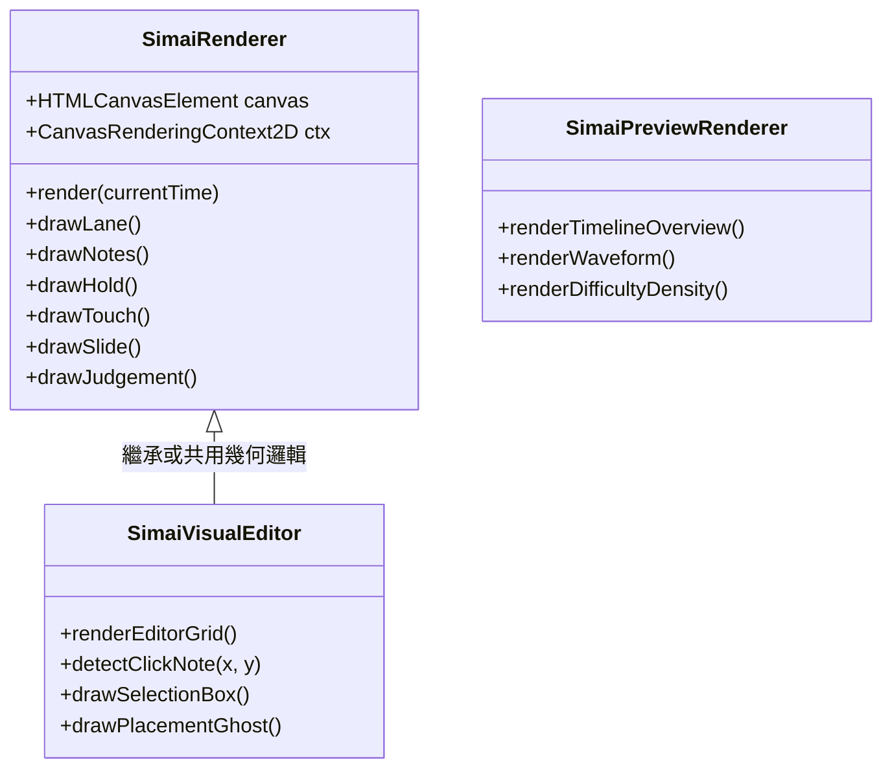

# Web mai Chart X - 渲染與音訊引擎詳解 (RENDERER_AND_AUDIO.md)

本文件深入說明專案最核心的兩大運算系統：**Canvas 譜面渲染引擎 (`renderer.js`)** 與 **Web Audio 音訊引擎 (`audioManager.js`)**。

---

## 🎨 1. Canvas 譜面渲染系統 (Scripts/renderer.js)

`renderer.js` 是全專案最複雜的檔案之一（逾 20 萬字節），內部封裝了三大多功能渲染類別：



### 1.1 座標系與八鍵判定環 (Geometry)
maimai 框體由圍繞圓心的 8 個主按鍵（1~8 號鍵）組成：
- 圓心通常定為 `(centerX, centerY)`。
- 按鍵角度：1 號鍵由上方偏右開始，依順時針每 45 度一個鍵位（透過 `chartGeometry.js` 計算）。
- 音符自圓心判定點向外圈判定環等速或依變速指令 `<HS*N>` 飛馳。

### 1.2 渲染管線 (Render Pipeline)
每幀在 `playbackEngine` 驅動下執行：
1. **背景清理與影片繪製**：若啟用背景影片/底圖，先畫底層並疊加使用者設定的暗度濾鏡（`bgBrightness`）。
2. **判定線與軌道環**：繪製 maimai 特徵的 8 條軌道線與主判定圓環。
3. **音符批次繪製（深度排序）**：
   - 先繪製 Slide 軌跡導引線（箭頭發光動畫與星星等待狀態）。
   - 繪製 Hold 與 TouchHold 延伸長條。
   - 繪製 Tap 音符、Break 音符（帶閃爍高光）、地雷音符 `m`。
   - 繪製 Touch 與 Touch 中心感應點。
4. **即時打擊反饋與特效**：Critical/Perfect/Great 特效環與分數評級指示。

### 1.3 ⚠️ 效能優化與快取關鍵（必讀陷阱）
- **Slide 軌跡與 spacing 快取**：
  Slide 繪製包含大量的貝茲曲線點位計算。渲染器會快取 Slide 幾何點。
  > [!IMPORTANT]
  > 當使用者修改譜面設定中的 `notebasesize`（音符基礎大小）時，必須連動清除或使 Slide 的 `spacing` 快取失效，否則 Slide 線上的箭頭間距不會即時反映新的尺寸大小。
- **音訊波形圖繪製快取 (Waveform)**：
  在預覽條（`SimaiPreviewRenderer`）繪製整個音訊的 PCM 波形振幅極耗 CPU。
  波形資料已採用**離屏 Canvas (Offscreen / Cached Canvas)** 機制，在音訊初次載入時只解算並繪製一次，後續每幀直接呼叫 `drawImage()` 貼圖，切勿在 render 迴圈內重複呼叫波形解碼。

---

## 🔊 2. Web Audio 音訊管理系統 (Scripts/audioManager.js)

`audioManager.js` 基於標準 Web Audio API，負責 BGM 背景音樂與低延遲打擊音效播放。

### 2.1 結構與音訊管線
```text
[BGM Source Node] ---------> [BGM GainNode] ---------> [AudioDestination (喇叭)]
                                  ^
                            (bgmVolume 設定)

[SE BufferSource] ---------> [SE GainNode]  ---------> [AudioDestination (喇叭)]
                                  ^
                        (seVolume * specificMultiplier)
```

### 2.2 打擊音效分類 (Sound Effects)
- **Tap 音效**：一般打擊音。
- **Break 音效**：金屬爆炸質感的特大音效。
- **Slide 音效**：星星滑動時的連續風聲。
- **Slide 判定完成音效 (`judge_break_slide` 等)**：滑條抵達終點時的打擊音。
- **Touch / TouchHold 音效**：觸控專用音效。

### 2.3 ⚠️ 音量控制與倍率換算（必讀陷阱）
> [!CAUTION]
> 專案中的打擊音效音量受到全域設定（`settingsConfig.js`）的分流控制：
> 1. 全域主音量 (`masterVolume`)
> 2. BGM 音量 (`bgmVolume`)
> 3. SE 主音量 (`seVolume`)
> 4. 特定判定音效音量倍率（如 `judge_break_slide`, `judge_tap` 等）

若需要呼叫音效播放函式：
- 必須先自 `appContext.settings` 獲取對應項目的音量設定值。
- 調用播放時確保傳入完整的 `gain` 計算，不可繞過 GainNode 直接連接 Destination，以防破壞使用者的自訂音量設定。
- 專案在背景分頁被暫停時，應透過 `audioContext.suspend()` 與 `resume()` 正確同步播放狀態，避免計時器與音訊硬體產生偏移。
